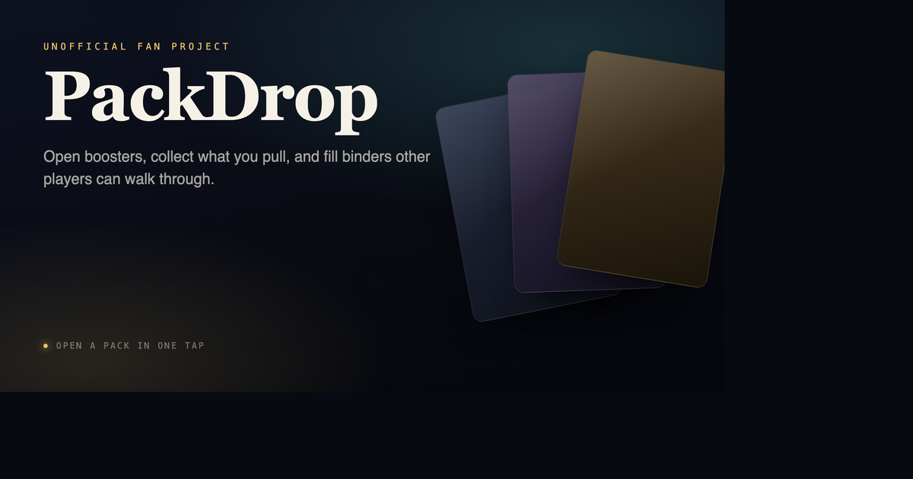

# PackDrop



A browser-based trading-card collection game. Open boosters built on **published pull
rates**, keep what you pull, fill binders other players can walk through, and trade from
a server-authoritative wallet.

**Status: closed playtest.** Feature-complete enough to hand to testers, not yet
released. Breaking changes between commits are expected.

**Play:** <https://nemixis.github.io/packdrop/>


---

## What it is

A collecting game that tries to be honest about its numbers. Booster composition is
modelled per set from published pull-rate studies — never invented. Where a tier has no
published data, the gap is documented in `docs/pull-rates.md` rather than filled with a
guess.

It is also a test of how far a static, buildless web app can go: no bundler, no
framework, no server except Postgres for the things that genuinely must be shared —
accounts, wallets, listings and public profiles.

## Features

- **Boosters with real rates** — per-set composition, rarity tiers, finishes, and a local
  copy of the scans so art cannot disappear mid-session
- **Collection** — dedupe, duplicates, per-set completion, live market valuation
- **Binders** — create as many as you like, public or private, each with its own cover,
  shelf and layout; visitors see the owner's choices
- **Atelier** — a cosmetics store: frames, banners with animated effects, name colours,
  binder covers and element shelves, bought with earned shards
- **Exchange** — list cards for shards, browse the board, seller profiles
- **Arena** — a single-player combat mode over your collection
- **Profiles** — public/shareable, with a showcase, stats and a share card
- **EN / FR** throughout, installable as a PWA, works offline once visited

## Stack

| Layer | What |
|---|---|
| Client | Vanilla JS, no framework, no build step |
| Hosting | GitHub Pages (static) |
| Backend | Supabase — Postgres, Auth, Row Level Security |
| Card data | [TCGdex](https://tcgdex.dev) (Pokémon), [Scryfall](https://scryfall.com) (MTG) |
| Offline | Service worker (`sw.js`), precached shell |

## Architecture

```
index.html    markup + game logic (~1.18 MB)
styles.css    the whole stylesheet (~543 KB) — extracted so a style change
              does not invalidate a 1.2 MB document
boot.js       telemetry, in-app feedback, first-run screen — loaded deferred,
              talks to the game only through window.__sb
sw.js         service worker: app shell + offline
manifest.json PWA manifest
assets/       card scans vendored locally (see Assets)
docs/         design and data documentation, including pull-rate sources
supabase/     schema inventory, hardening migration, RLS notes, monitoring views
scripts/      backup.sh, data generation
tests/        syntax gate + Playwright browser suites
```

**Why buildless.** The app can be served from any static host, forked by copying files,
and opened offline. The cost is real and worth stating: the remaining game logic is one
~1.1 MB script sharing a single closure, so it is not split into modules until there is a
build step to bundle it safely.

## Security model

Anything a client can name, a client can mint — so the client never names an amount.

- **Wallet writes are server-side.** `wallet_import` (a one-shot migration) is
  `service_role` only; it used to mint 5,000 shards from a client-supplied number.
- **Earn reasons are capability rows.** `wallet_credit` credits only reasons that exist in
  `wallet_caps`, and a reason the UI never pays is a pure faucet — the `recycle` row
  (5,000/day) was deleted for exactly that. Client-mintable ceiling went 8,600 → 600/day.
- **Verified earns where they can be.** `claim_daily_login` checks the claim date itself;
  a second claim returns `claimed: false`.
- **RLS on all 22 tables**, policies scoped to `auth.uid()`; config tables are deny-all
  and reachable only through security-definer functions.
- **Logs are write-only.** Telemetry, feedback and reports accept inserts and deny reads,
  so one player's events cannot be read by another.

Details and the migrations that produced this are in `supabase/hardening-2026-11.sql`.

## Run it locally

No dependencies. Any static server works:

```bash
python3 -m http.server 8899
# open http://127.0.0.1:8899/index.html
```

`file://` will not work — the service worker and card fetches both need an origin.

## Testing

```bash
node tests/jscheck.js
```

Extracts every inline `<script>` from `index.html` and parses it. With no build step,
nothing else catches a stray brace — the failure mode is a blank screen. This gate runs
**in CI on every push and PR** (`.github/workflows/ci.yml`).

Browser suites live in `tests/pdhelper.py` (Playwright): they drive a real browser, open
packs and assert against rendered state. Run manually — they need a local server and a
fresh profile.

## Data and drop rates

Booster composition is modelled per set from published pull-rate studies; the tables and
their sources are in `docs/pull-rates.md`. Card metadata and art are fetched at runtime
and cached in `localStorage`; only the scans under `assets/` are vendored.

## Assets

The scans in `assets/30c/` are the **Classic Collection** reprints from the 30th
Celebration set. TCGdex publishes their metadata but no artwork, so the scans were sourced
from [pokecardex](https://www.pokecardex.com) and vendored here so the art cannot vanish
mid-session.

They are **official card scans, © their respective rights holders** — see `NOTICE.md`.

## Roadmap

- [x] Boosters, collection, binders, exchange, atelier, profiles, arena (single-player)
- [x] Server-authoritative wallet, RLS, verified daily login
- [x] Telemetry, in-app feedback, first-run screen
- [ ] Trading between players
- [ ] Quest / arena earn verification (currently capped, not proven)
- [ ] Automated database backups + point-in-time recovery
- [ ] Module build step for the remaining game logic

## Legal

PackDrop is an **unofficial, non-commercial fan project**. It is not affiliated with,
endorsed by or sponsored by Nintendo, Creatures Inc., GAME FREAK, The Pokémon Company,
Wizards of the Coast, Square Enix or Hasbro.

- **Code** (`index.html`, `styles.css`, `boot.js`, `sw.js`, `tests/`): MIT — see `LICENSE`.
- **Card artwork and card data**: property of their respective rights holders, used here
  under fan-project terms. Not covered by the MIT licence. Full attribution in `NOTICE.md`.

## Contributing

Changes land on `main` only through the CI gate. Keep gameplay logic and presentation
separate: `docs/redesign.md` covers the art direction, and `docs/pull-rates.md` is the
reference for anything that changes what a booster contains.
